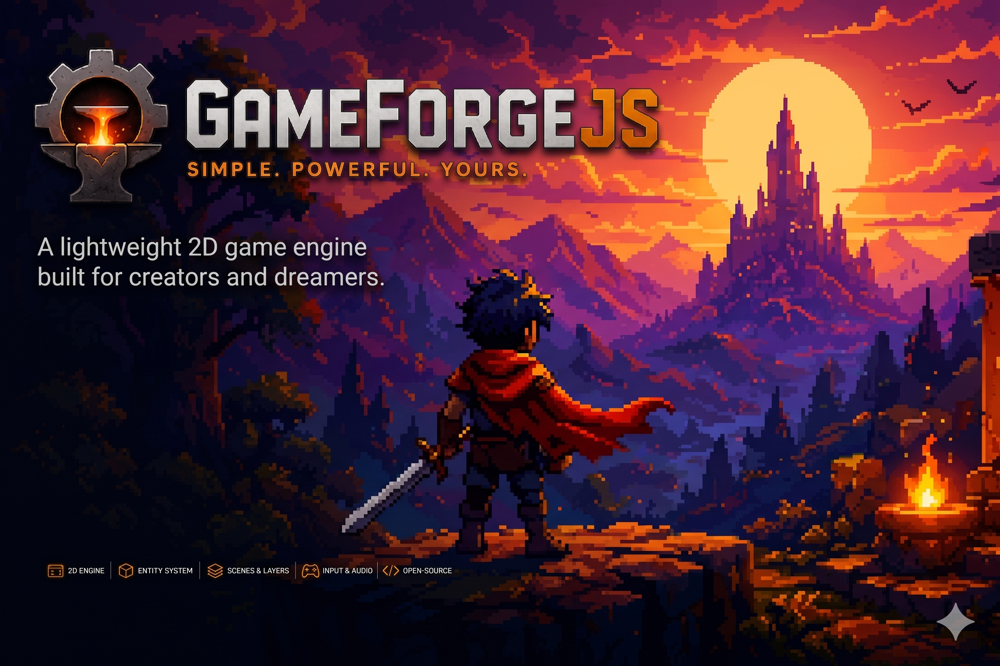

<p align="center">
  
</p>

# GameForgeJS

GameForgeJS is an experimental JavaScript framework for browser games.
It includes a shared runtime, Canvas 2D and WebGL2 rendering, networking
helpers, a local project CLI, and playable examples.

The browser runtime uses native JavaScript and browser APIs. Node.js runs the
development CLI, validation, documentation generation, and static builds.

## Start here

GameForgeJS runs as native browser JavaScript. Node.js and the CLI are optional
development tools; an ordinary static HTTP server can serve the engine and game.

## Principles

- Keep the runtime independent of external dependencies and build tools.
- Use `BootstrapGame`, `Level` / `Level3D`, and `GameObject` as the main game pattern.
- Let `Screen` and the framework's rendering classes own canvas creation and drawing.
- Keep screen, input, and window configuration owned by each game.
- Describe assets and levels through manifests; evolve inheritance with components.
- Keep authoring tools separate. Optional extensions must reuse framework services.

See [Architecture and ownership](docs/architecture.md) for how these pieces fit.

## Run the examples

From a repository checkout:

```sh
npm ci
npm start
```

Open the URL printed by the server and visit
`/examples/showcase/index.html`. Each example also has its own `index.html`.
Existing `Main.html?demo=advanced` links redirect to the corresponding game.

To create a separate game from this checkout:

```sh
node cli/index.cjs create ../my-game --template minimal-2d
node cli/index.cjs serve --root ../my-game
```

Use `minimal-3d` for a WebGL2 starter. These commands use the local engine
checkout; they do not assume a package has been published to npm.
See [Create a project](docs/getting-started/new-project.md) for the project
layout and [CLI reference](docs/reference/cli.md) for all commands.

## Public imports

CLI-generated games follow the established `BootstrapGame`/`Level` pattern:

```js
import { BootstrapGame, Level } from "gameforgejs/core";
import { GameObject, Screen, Draw } from "gameforgejs/2d";
```

The generated project's import map resolves these public names in the browser.
The separate `createGame` API is also available for projects that need
independent runtime instances. Package exports provide the same public names
for package-aware tooling. Internal implementation files live only in `src/`;
do not import them through deep paths or create a parallel `packages/` facade.

## Repository layout

```text
src/
  core/                 Game lifecycle, configuration, assets, input, math
  2d/                   Canvas rendering and existing 2D game APIs
  3d/                   WebGL2 rendering, scenes, materials, physics
  network/              Transports and synchronization helpers
cli/
  templates/            Minimal executable game starters
examples/
  catalog.json          Metadata consumed by the showcase and this table
  showcase/             Example browser, independent of the runtime
  <purpose>-2d/ or <purpose>-3d/
    index.html          Browser entry
    main.js             Game bootstrap
    config/             Game settings, resource manifest and tooling metadata (migrated projects)
    src/                Levels, screens, entities, and game systems
    assets/             Game resources
scripts/                Repository checks and documentation generation
tests/                  Automated regression and contract checks
docs/                   Canonical English documentation
```

Not every example needs every optional file or source subdirectory.
`resources.json` declares loaded assets; `game.workspace.json`, when
present, is metadata for an external editor.

## Examples

The showcase is intended for exploration and integration examples. New games
start from CLI templates, which contain only the minimum runnable behavior.

<!-- examples:start -->
| Example | Dimension | Purpose |
| --- | --- | --- |
| [Aether Observatory 3D](examples/aether-observatory-3d/index.html) | 3D | Native WebGL floating islands, shaded architecture, fog, physics traversal, orbit/chase cameras and a skippable cinematic. |
| [Cinematic Crossing 2D](examples/cinematic-crossing-2d/index.html) | 2D | Parallel camera, zoom and fade tracks, waypoint movement, dialogue cues and clean skip/replay control states. |
| [Route Atlas 2D](examples/route-atlas-2d/index.html) | 2D | A branching overworld graph, smooth node travel, playable shard trials and event-driven stage unlocks. |
| [Boss Patterns 2D](examples/boss-patterns-2d/index.html) | 2D | A three-phase boss with aimed fans, rings, marked charges, delayed hazards, pooled projectiles and dash invulnerability. |
| [Storm Foundry FX Lab 2D](examples/storm-foundry-2d/index.html) | 2D | Layered rain, reactive water reflections, dynamic props, bounded particle pools and an in-engine live FX playground. |
| [Toon Adventure 3D](examples/toon-adventure-3d/index.html) | 3D | A Toon ABS sandbox with two large lakes, linked warp gates, five sentries and shallow-water interaction. |
| [Platformer Building Blocks 2D](examples/platformer-2d/index.html) | 2D | Two compact stages demonstrating tile collision, jump buffering, coyote time, collection and level transitions. |
| [Movement & Collision 2D](examples/movement-collision-2d/index.html) | 2D | A compact 2D example for movement, collision, and collection. |
| [Component Adventure 2D](examples/component-adventure-2d/index.html) | 2D | Top-down movement, reusable entity components, and room camera transitions. |
| [Platform Adventure 2D](examples/platform-adventure-2d/index.html) | 2D | Platform combat, patrol and pursuit AI, line of sight, inventory, skills and manifest-authored stages. |
| [Tactical RPG 2D](examples/tactical-rpg-2d/index.html) | 2D | A turn-based grid game with pathfinding, movement range, and combat. |
| [Fighting Arena 2D](examples/fighting-2d/index.html) | 2D | Energy spheres, meter-powered supers, buffered melee chains, reactive CPU, local versus and four character profiles. |
| [Puzzle Battle 2D](examples/puzzle-battle-2d/index.html) | 2D | An arcade puzzle game with combos and competitive block exchanges. |
| [Renderer Showcase 3D](examples/renderer-3d/index.html) | 3D | A Render3D scene exploring cameras, models, lighting, materials, and shadows. |
| [Solar System 3D](examples/solar-system-3d/index.html) | 3D | Procedural celestial materials, sunlight, and animated planetary orbits. |
| [Sky Trail 3D](examples/sky-trail-3d/index.html) | 3D | Four expeditions, a gamepad-ready 3D menu, moving platforms, checkpoints and collectibles. |
| [Online Sandbox 2D](examples/online-sandbox-2d/index.html) | 2D | Cooperative mining/building, dedicated server rooms, predicted movement and mobile controls; backend required. |
| [Addon Building Blocks 2D](examples/addons-2d/index.html) | 2D | Shared parallax layers and a patrol/rest state machine using the standard framework lifecycle. |
| [Touch Garden 2D](examples/touch-garden-2d/index.html) | 2D | Mobile building blocks: identified multi-touch, a virtual stick, a simultaneous dash action, collision and collectible entities. |
<!-- examples:end -->

## Documentation

- [Documentation index](docs/index.md)
- [Create a project](docs/getting-started/new-project.md)
- [Learn from 2D and 3D examples](docs/getting-started/tutorial-demos-2d-3d.md)
- [Architecture and ownership](docs/architecture.md)
- [Standalone runtime and repository split proposal](docs/plans/repository-split.md)
- [Migrate existing code](docs/migrations/repository-layout.md)
- [CLI reference](docs/reference/cli.md)
- [Input configuration](docs/getting-started/input-config.md)
- [Components](docs/guides/components.md)
- [3D rendering](docs/guides/render3d.md)
- [Networking](docs/guides/network.md)

English is the canonical documentation language. API reference pages are
generated from public source JSDoc; the example list above is generated from
`examples/catalog.json`. Edit those sources, then run `npm run docs`.

## Validate changes

```sh
npm run check
npm test
npm run test:browser
npm run docs
npm run docs:check
```

Run a changed example in a browser as well. Syntax and resource checks cannot
prove rendering, game input, or GPU behavior.

## Current boundaries

The game-instance API introduces explicit module setup and disposal.
Existing static engine, input, screen, and asset APIs remain available for
older examples; they must not be assumed to support several simultaneous
games in one page. See the architecture guide for the compatibility boundary.

External authoring applications and multiplayer servers are separate
projects. The local development server does not provide a game backend.

See the [complete examples index](examples/README.md) for canonical demo names,
controls, learning paths and the mobile Touch Garden building blocks.
